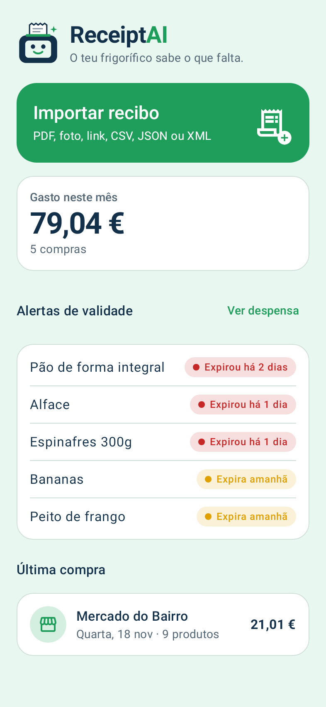
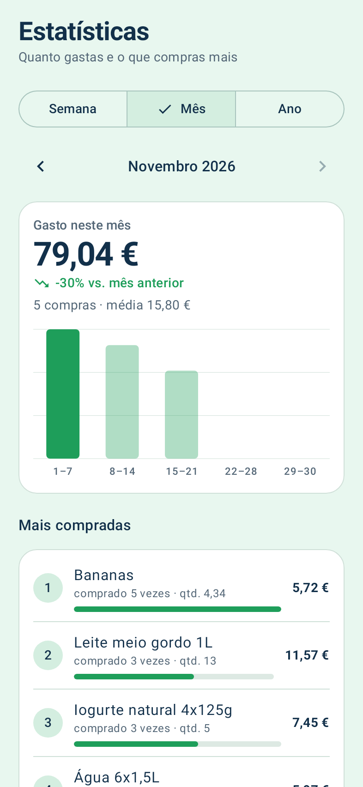
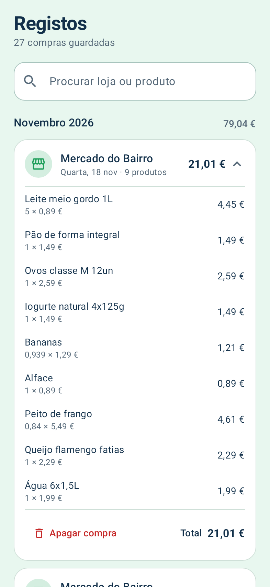
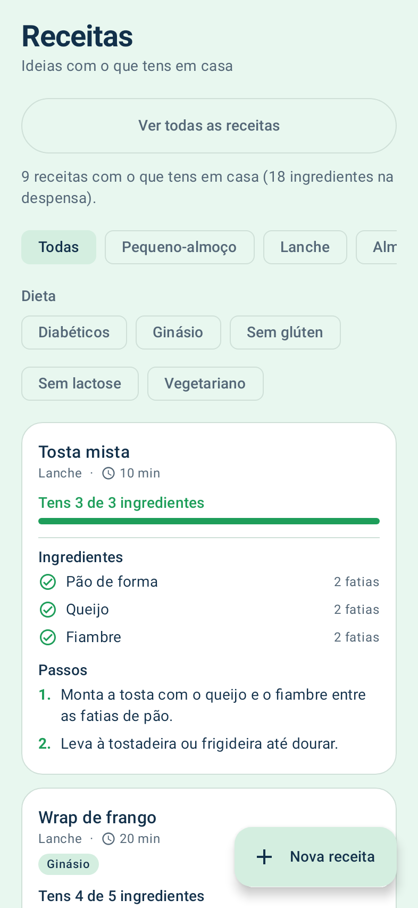

# ReceiptAI

**O teu frigorífico sabe o que falta.**

ReceiptAI junta duas peças:

- um **robô físico** que se prende à porta do frigorífico com ímanes e lê os recibos;
- uma **aplicação móvel** (Android, em Kotlin) que guarda as compras numa base de dados pessoal.

Com essas compras, a app mostra estatísticas, avisa quando a comida está a estragar, sugere receitas com o que há em casa e faz a lista de compras sozinha.

> Projeto do "Desafio Empreendedor – Cria, Resolve, Convence!". O Cartão de Identidade, o Guia de Montagem e o modelo 3D estão em [`docs/projeto/`](docs/projeto/).

<p align="center">
  
  
  
  
</p>

## Vídeo

[`video/ReceiptAI_demo_30s.mp4`](video/ReceiptAI_demo_30s.mp4): vídeo 3D de 30 s feito com o modelo do robô (`ReceiptAI_montado.glb`) e com os ecrãs reais da app.

- **Cenário:** uma cozinha com azulejo português, chão de madeira e um frigorífico branco lacado (porta com dobradiças, post-it, calendário e ímanes).
- **Luz:** um candeeiro pendente de luz quente ilumina o robô; numa taça há laranjas com casca porosa.
- **Recibo:** em papel térmico, curvo e dobrado. Passa pelos rolos do robô e sai por baixo.
- **Texturas:** são todas desenhadas em código, em [`video/textures.js`](video/textures.js).

## Funcionalidades

- **Ler recibos em vários formatos**
  - PDF e imagens.
  - Recibos físicos, com a câmara: digitaliza e guarda no telemóvel.
  - Links online (URL).
  - "Partilhar com ReceiptAI" a partir do e-mail ou do browser.
  - CSV, JSON e faturas eletrónicas XML (UBL e SAF-T).
  - Antes de guardar, o ecrã **Rever recibo** deixa corrigir produtos e preços.
- **Estatísticas**: quanto dinheiro gastaste nesta **semana, mês ou ano**, a comparação com o período anterior, um gráfico e as **coisas compradas mais vezes**.
- **Registos**: todas as compras, com o preço. **Ao tocar numa compra, abre um menu** com todos os produtos dessa compra. Também dá para pesquisar e apagar.
- **Despensa**: guarda os ingredientes com a validade estimada e **avisa** (notificação diária) quando estão a chegar ao fim do prazo.
- **Lista de compras automática**: aprende o que compras com regularidade e sugere o que já deve estar a acabar.
- **Receitas**:
  - o botão **"O que posso cozinhar?"** examina os ingredientes da despensa e devolve as receitas possíveis;
  - mostra o que falta, que podes juntar à lista de compras;
  - **filtros de dieta**: diabéticos, ginásio, sem glúten, sem lactose e vegetariano;
  - **Nova receita**: o botão para inserir receitas com ingredientes e passos.

## Como experimentar

1. Instala o Android Studio (versão recente).
2. Abre esta pasta (`File > Open`). O Android Studio descarrega o Gradle e as bibliotecas sozinho.
3. Carrega em ▶ **Run** com um telemóvel ligado por USB ou com um emulador.
4. No ecrã Início, toca em **"Experimentar com dados de exemplo"** para ver a app com 3 meses de compras fictícias.
5. Para testar a leitura, envia para o telemóvel um dos ficheiros de [`docs/exemplos/`](docs/exemplos/) e usa **Importar recibo → Escolher ficheiro**.

Pela linha de comandos:

```bash
./gradlew assembleDebug        # cria app/build/outputs/apk/debug/app-debug.apk
./gradlew testDebugUnitTest    # corre os testes (39)
./gradlew recordRoborazziDebug # gera as capturas de ecrã em docs/screenshots
```

## Como está organizado (para aprender)

| Pasta | O que tem |
|---|---|
| `app/src/main/java/pt/receiptai/parser/` | Lê o texto/ficheiro do recibo → produtos, preços, data e loja. |
| `.../importer/` | Recebe o recibo (ficheiro, câmara, link) e escolhe o leitor certo. Inclui o OCR do ML Kit. |
| `.../domain/` | As "regras" da app: dinheiro em cêntimos, validades, estatísticas, lista automática, receitas. |
| `.../data/` | Base de dados **Room** (tabelas e consultas) e repositórios. |
| `.../ui/` | Ecrãs em **Jetpack Compose** (um ViewModel por ecrã) e o tema com as cores do logótipo. |
| `.../work/` | Tarefa diária (WorkManager) que envia os avisos de validade. |
| `app/src/test/` | Testes: parsers, contas, base de dados e capturas de ecrã. |
| `docs/` | Projeto original, exemplos de recibos, capturas e o formato JSON. |
| `video/` | Cena 3D (three.js) que gera o vídeo: `npm install` e depois `node render.cjs`. |

Decisões importantes:

- **MVVM**: o ecrã mostra um *estado*; o ViewModel calcula esse estado a partir da base de dados.
- **Dinheiro em cêntimos (`Long`)**, nunca em `Double`, para não haver erros de arredondamento.
- **OCR no telemóvel (ML Kit)**: é grátis, funciona sem Internet e as fotos dos recibos não saem do telemóvel.
- **Formato `receiptai-v1`**: o JSON que o robô envia para a app. Ver [`docs/formato-recibo.md`](docs/formato-recibo.md).

## Cores

| | Claro | Escuro |
|---|---|---|
| Verde (botões) | `#1E9E5A` | `#2FBF73` |
| Fundo | `#E8F7EF` | `#0F2539` |
| Cartões | `#FFFFFF` | `#142C43` |
| Texto | `#12304A` | `#E8F7EF` |
